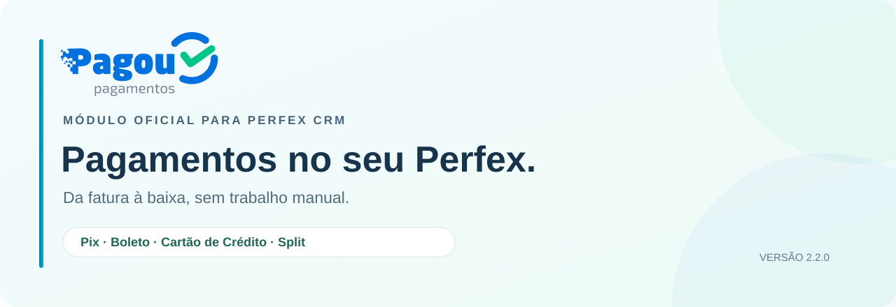

<p align="center">
  
</p>

<p align="center">
  <strong>Pagamentos integrados. Baixa automática. Código aberto.</strong><br>
  O módulo oficial da Pagou para receber as faturas do Perfex CRM.
</p>

<p align="center">
  <a href="https://github.com/pagou-com-br/perfex-crm/releases/tag/v2.2.0"></a>
  <a href="#requisitos"></a>
  
  <a href="#testes"></a>
  <a href="https://github.com/pagou-com-br/perfex-crm/releases/tag/v2.2.0"></a>
</p>

<p align="center">
  <a href="https://github.com/pagou-com-br/perfex-crm/releases/download/v2.2.0/pagou-perfex-2.2.0.zip"><strong>Baixar Pagou para Perfex CRM (.zip)</strong></a>
  &nbsp;·&nbsp;
  <a href="https://github.com/pagou-com-br/perfex-crm/releases/tag/v2.2.0">Release notes</a>
  &nbsp;·&nbsp;
  <a href="https://github.com/pagou-com-br/perfex-crm/releases/download/v2.2.0/SHA256SUMS">Checksum SHA-256</a>
</p>

<p align="center">
  <a href="#recursos">Recursos</a> ·
  <a href="#instalacao">Instalação</a> ·
  <a href="#configuracao">Configuração</a> ·
  <a href="#permissoes">Permissões</a> ·
  <a href="#seguranca">Segurança</a> ·
  <a href="#testes">Testes</a> ·
  <a href="#suporte">Suporte</a>
</p>

> **Pré-release `2.2.0`.** Valide a integração numa instalação de teste do Perfex,
> com a conta de Sandbox da Pagou, antes de usar em produção. Cartão e Split
> dependem de habilitação na conta Pagou.

O Pagou para Perfex CRM coloca Pix, boleto e cartão de crédito dentro das faturas
do Perfex. O cliente paga pela própria fatura, e o pagamento é registrado
automaticamente, sem conferência manual.

<a id="recursos"></a>

## Recursos

| Recurso | O que faz |
| --- | --- |
| **Pix** | QR Code imediato ou Pix com vencimento da fatura, com multa, juros e desconto |
| **Boleto** | Emissão automática ao criar a fatura, com multa, juros, desconto, carência e Pix vinculado |
| **Cartão de crédito** | Pagamento na própria fatura com tokenização no navegador, à vista ou parcelado, e estorno pelo admin |
| **Split** | Repasse automático a recebedores, por regra global ou por cliente |
| **Baixa automática** | Webhook assinado e reconciliação pelo cron, para quando o webhook não chega |
| **Pix avulso** | Cobranças fora de fatura, com página pública de pagamento |
| **Reembolso** | Devolução de Pix pelo admin |

<a id="requisitos"></a>

## Requisitos

- Perfex CRM 3.2.0 ou superior, com o cron configurado.
- Conta na [Pagou](https://pagou.com.br) e chave de API (Sandbox para testes, Produção para receber).
- Faturas em `BRL`.
- Cartão de crédito: credenciamento de cartão aprovado na Pagou.
- Split: split habilitado na conta e recebedores autorizados no painel da Pagou.

<a id="instalacao"></a>

## Instalação

1. [Baixe o .zip da versão 2.2.0](https://github.com/pagou-com-br/perfex-crm/releases/download/v2.2.0/pagou-perfex-2.2.0.zip).
2. No Perfex, vá em **Setup → Modules → Upload Module**, envie o arquivo e clique em **Activate** no módulo **Pagou Integração Perfex CRM**.
   Se preferir, descompacte o .zip e copie a pasta `pagou` para `modules/` no servidor.
3. Se o Perfex pedir para atualizar o banco de dados, confirme. Até isso ser feito, a emissão automática e os webhooks ficam pausados.
4. Confira o cron do Perfex em **Setup → Settings → Cron Job**. Ele faz a reconciliação e a emissão automática de boletos.

### Atualização a partir da 1.x

Envie o .zip novo do mesmo jeito (ou substitua a pasta `modules/pagou`) e confirme a atualização do banco de dados. As faturas já existentes ficam fora da emissão automática de boleto, para não gerar cobranças do histórico.

<a id="configuracao"></a>

## Configuração

Em **Setup → Settings → Payment Gateways**, cada meio de pagamento tem sua aba: **Pagou Pix**, **Pagou Boleto** e **Pagou Cartão**.

- **Chave de API:** use a chave do mesmo ambiente escolhido. Ela é guardada criptografada.
- **Ambiente:** comece em Sandbox (`api.pagou.cloud`) e passe para Produção (`api.pagou.com.br`) depois de testar.
- **Webhook:** a URL padrão é `https://SEU-PERFEX/pagou/pagou_webhook/process` e vai automaticamente em cada cobrança. A assinatura (`X-Pagou-Signature`) é conferida com a chave de API.

### Cartão de crédito

- **Parcelas:** número máximo e valor mínimo por parcela.
- **IP do comprador (antifraude):**
  - `remote`: o Perfex recebe o acesso direto, sem proxy;
  - `xff`: há um nginx ou balanceador na frente. Informe as faixas dele em **proxies confiáveis**;
  - `cloudflare`: o site passa pela Cloudflare. Informe as faixas da Cloudflare em **proxies confiáveis**.

### Split

1. Habilite o split na conta Pagou e autorize os recebedores no painel da Pagou.
2. Ative a opção **SPLIT** nos meios de pagamento em que ele deve valer.
3. Em **Pagou → Split de Pagamento**, cadastre os recebedores e as regras, globais ou por cliente.

A regra do cliente prevalece sobre as globais, e o tipo "sem split" isenta o cliente. A soma dos percentuais respeita uma margem mínima para as tarifas (10% por padrão).

<a id="permissoes"></a>

## Menu e permissões

O menu **Pagou** no admin traz PIX Avulso, Reembolso de Pagamentos, Cobranças de Cartão, Split de Pagamento e Configurações. O acesso é controlado em **Setup → Staff → Roles**, em **Pagou Integração**:

| Permissão | Libera |
| --- | --- |
| Acessar PIX Avulso | Criar e consultar Pix avulsos |
| Acessar Reembolso de Pagamentos | Devolver pagamentos Pix |
| Estornar cobranças de cartão | Estornar cobranças de cartão |
| Configurar split de pagamento | Recebedores e regras de split |

<a id="seguranca"></a>

## Segurança e privacidade

- Número e CVV do cartão nunca passam pelo servidor do Perfex: a tokenização é feita no navegador.
- Os webhooks são autenticados por HMAC-SHA256, com janela de 5 minutos, e cada evento é processado uma única vez.
- Cada pagamento recebe uma única baixa, mesmo que o webhook e o cron cheguem juntos.
- CPF, CNPJ, e-mail e outros dados pessoais são mascarados nos logs.

<a id="testes"></a>

## Testes

```bash
bash tests/integration/run.sh
```

Os testes de integração usam MariaDB em Docker e uma API simulada, sem chamadas à Pagou. Veja [tests/integration/README.md](tests/integration/README.md).

<a id="suporte"></a>

## Suporte

- Documentação da API: https://docs.pagou.com.br
- Pagou: https://pagou.com.br
- Problemas no módulo: [abra uma issue](https://github.com/pagou-com-br/perfex-crm/issues)
